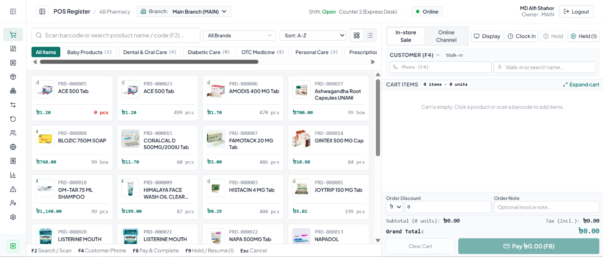
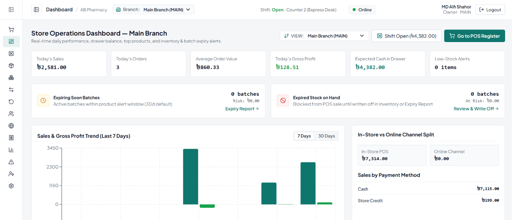
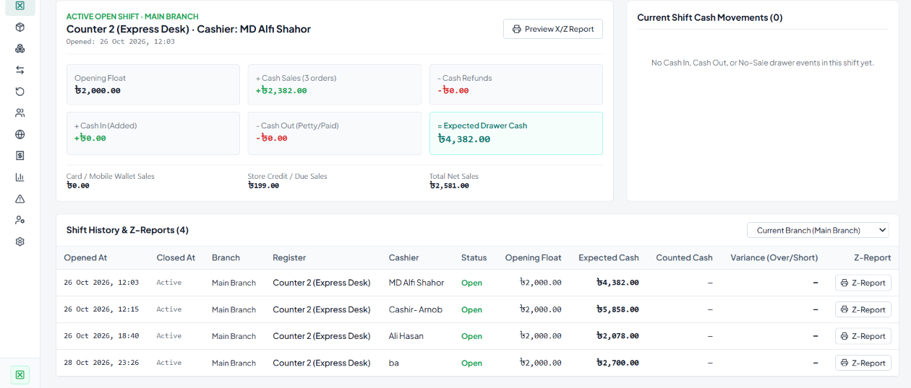
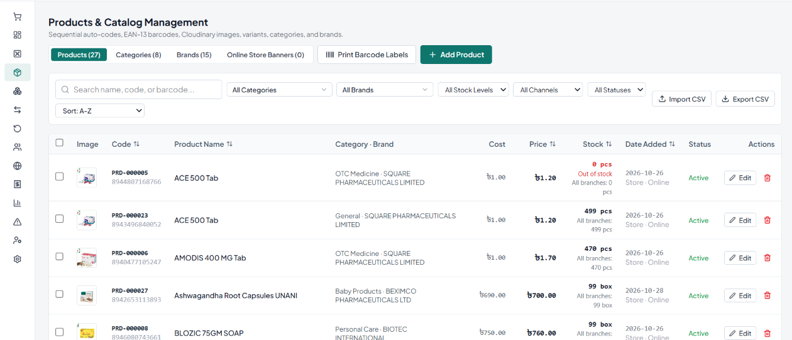
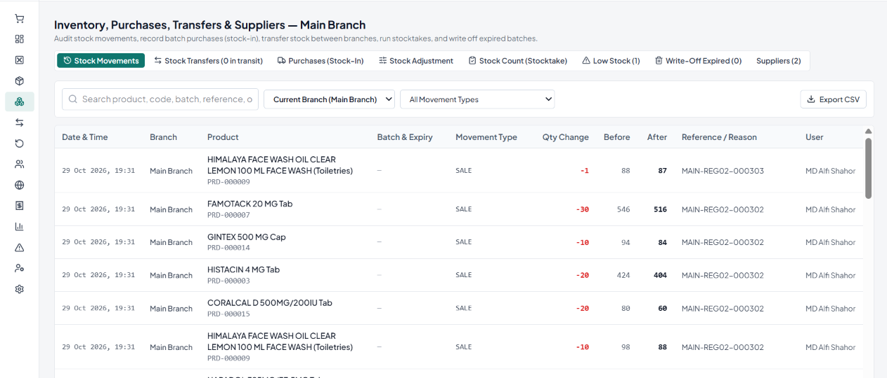
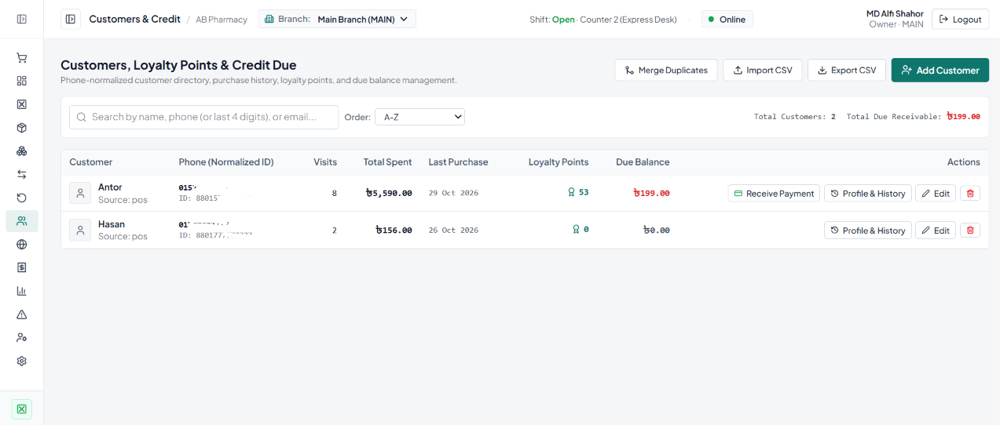

# Mercantile POS & Inventory Management System

**Author:** MD Alfi Shahor  
**Architecture:** Multi-Branch · Offline-First PWA · Real-Time Cloud Sync · FEFO Batch Tracking

A production-grade **Retail Point of Sale (POS) and Inventory Management System** built with **React 19, TypeScript, Tailwind CSS, Firebase (Firestore & Authentication), and IndexedDB (Dexie.js)**. Designed for single-store and multi-branch retail businesses, pharmacies, supermarkets, and warehouses, it keeps checkout operations running smoothly even when the internet connection drops.

---

## Table of Contents

1. [Key Highlights](#key-highlights)
2. [Core Modules & Features](#core-modules--features)
   - [1. High-Speed POS Register](#1-high-speed-pos-register)
   - [2. Offline-First POS Mode & Installable PWA](#2-offline-first-pos-mode--installable-pwa)
   - [3. Multi-Branch & Warehouse Management](#3-multi-branch--warehouse-management)
   - [4. Inter-Branch Stock Transfers](#4-inter-branch-stock-transfers)
   - [5. FEFO Batch & Expiry Tracking](#5-fefo-batch--expiry-tracking)
   - [6. Customer CRM, Loyalty Points & Credit/Due Ledger](#6-customer-crm-loyalty-points--creditdue-ledger)
   - [7. Customer-Facing Secondary Display](#7-customer-facing-secondary-display)
   - [8. Cash Drawer, Shifts & Staff Attendance](#8-cash-drawer-shifts--staff-attendance)
   - [9. Inventory, Purchasing & Stocktakes](#9-inventory-purchasing--stocktakes)
   - [10. Returns, Online Orders, Expenses & Reports](#10-returns-online-orders-expenses--reports)
3. [Role-Based Access Control (RBAC)](#role-based-access-control-rbac)
4. [Tech Stack](#tech-stack)
5. [Project Structure](#project-structure)
6. [Getting Started](#getting-started)
7. [Keyboard Shortcuts](#keyboard-shortcuts)
8. [Testing & Verification](#testing--verification)
9. [Author](#author)

---

## Key Highlights

- **Zero-Downtime Checkout:** Works seamlessly online and offline. Offline sales, customer registrations, cash drawer shifts, and attendance logs are stored locally in IndexedDB and automatically synced when internet connectivity returns.
- **Multi-Branch Ready:** Operate a single shop or scale to multiple retail branches and warehouses. Products, categories, brands, and customers are shared globally, while stock quantities, batches, registers, shifts, and sales are isolated per branch.
- **Atomic Stock Integrity:** Inventory updates use Firestore atomic increments (`FieldValue.increment`) inside transactions so concurrent checkouts across registers never overwrite stock levels.
- **Pharmacy & Grocery Ready (FEFO):** Full batch and expiry date management with automatic **First-Expired, First-Out (FEFO)** stock allocation and optional PIN-verified Manager Overrides.

---

## Screenshots

### POS Register


### Dashboard


### Cash Drawer & Shifts


### Products & Catalog


### Inventory


### Customers & Credit


## Core Modules & Features

### 1. High-Speed POS Register
- **Barcode & Search:** Instant search by product name, SKU code, or barcode scanner wedge (`F2`), plus A–Z quick filter and Category/Brand filtering with live item counts.
- **Flexible Cart Controls:** Supports standard units (`pcs`, `box`, `pack`) and decimal units (`kg`, `litre`), product variants, per-line discounts, and order-level fixed or percentage discounts.
- **Compact & Expandable Cart Layout:** Collapsible Customer panel and one-click **Expand Cart** mode to inspect large multi-item orders without scrolling clutter.
- **Split & Multi-Tender Payments:** Accept Cash, Card, Mobile Wallet, or Customer Credit (Due) in a single or split transaction, with quick cash denomination buttons and automatic change calculation.
- **Hold & Resume Carts (`F9`):** Park incomplete carts per branch and resume them at any register.
- **Receipt Printing:** Supports 58mm/80mm thermal receipts and A4 invoices with customizable branch headers, footers, and tax registration details.

### 2. Offline-First POS Mode & Installable PWA
- **Installable PWA:** Built with `vite-plugin-pwa` (Workbox) to precache the application shell (HTML, JS, CSS, fonts, icons) and runtime-cache product thumbnails.
- **Dual-Layer Local Persistence:**
  - **Firestore Persistent Cache:** Multi-tab IndexedDB persistence (`persistentLocalCache` + `persistentMultipleTabManager`).
  - **Dexie.js Local Store:** Dedicated IndexedDB tables for products, branch stock, batches, customers (indexed by phone), active carts, and the offline transaction outbox.
- **Live Connectivity Monitor:** Top-bar indicator (`Online`, `Offline`, `Syncing`, `Sync Problem`) with active heartbeat checks, outbox queue inspector, manual `Sync Now`, and emergency JSON backup export.

### 3. Multi-Branch & Warehouse Management
- **Branch Types:** Create `shop` branches (available on POS and inventory) and `warehouse` branches (hold stock and send/receive transfers, hidden from POS selling screen).
- **One-Click Safe Migration:** Existing single-store businesses can enable multi-branch mode in Settings with an automated backup and migration tool that assigns historical records to the `Main Branch`.
- **Per-Branch Pricing Overrides:** Configure optional branch-specific selling prices (`branchPrices`) while maintaining a global product catalog.

### 4. Inter-Branch Stock Transfers
- **Full Lifecycle Tracking:** `Draft` → `In Transit` → `Received` / `Partially Received (with Discrepancy)` / `Cancelled`.
- **Two-Step Atomic Stock Movement:**
  - **Dispatch (`Send`):** Deducts stock from the sending branch and records a `transfer_out` stock movement.
  - **Receipt (`Receive`):** Adds received quantities to the destination branch, records `transfer_in` movements, and logs any transit shortage or damage discrepancy notes.

### 5. FEFO Batch & Expiry Tracking
- Track batch numbers, manufacturing dates, cost prices, and expiry dates per branch.
- **Automatic FEFO Allocation:** Automatically deducts from the earliest-expiring non-expired batch during checkout, even splitting across multiple batches when needed.
- **Expiry Safeguards:** Highlights near-expiry batches and blocks expired stock sales unless a Manager enters a valid override PIN (works both online and offline via SHA-256 hashed PIN verification).

### 6. Customer CRM, Loyalty Points & Credit/Due Ledger
- **Phone-Based Auto Recognition (`F4`):** Type a phone number (or last 4 digits) at checkout to instantly match existing customers or register a new customer inline.
- **Loyalty Program:** Automatically calculates earned points per sale and allows point redemption at checkout.
- **Credit / Due Management:** Track customer credit limits, outstanding due balances, and record partial or full due collections.

### 7. Customer-Facing Secondary Display
- **Dual-Screen Support:** Open a secondary display window on the same terminal (`BroadcastChannel`—works 100% offline) or pair an external tablet/monitor using a per-register pairing code.
- **Live Updates:** Displays active cart items, unit prices, discounts, tax, grand total, branch branding, promotional slides, customer phone self-entry, and a Thank-You screen upon payment completion.

### 8. Cash Drawer, Shifts & Staff Attendance
- **Shift Management:** Open shifts with an opening float, record `Cash In` / `Cash Out` drawer movements, and close shifts with expected vs. counted cash variance reporting.
- **Staff Clock-In / Clock-Out:** Built-in attendance tracking directly from the POS bar (works offline and syncs automatically).

### 9. Inventory, Purchasing & Stocktakes
- **Purchase Orders (PO):** Record supplier purchases with automatic stock and batch creation, plus supplier due tracking.
- **Stock Adjustments & Stocktakes:** Log damaged, expired, or lost stock adjustments and perform full physical inventory counts with variance reconciliation.

### 10. Returns, Online Orders, Expenses & Reports
- **Sales & Refunds:** Look up past invoices (including offline-created sales), process full or partial item returns, and automatically restock returned goods.
- **Online Orders Pipeline:** Manage e-commerce/phone orders through `New` → `Confirmed` → `Packed` → `Shipped` → `Delivered` statuses.
- **Branch & Consolidated Reports:** View Sales, Profit & Loss, Tax, Inventory Valuation, Low Stock, Expiry, Staff Performance, and Expense reports per branch or combined across all branches.

---

## Role-Based Access Control (RBAC)

| Capability | Owner | Manager | Cashier |
| :--- | :---: | :---: | :---: |
| POS Checkout, Hold Cart & Customer Lookup | Yes | Yes | Yes |
| Open / Close Own Cash Shift | Yes | Yes | Yes |
| Process Sales Returns & Refunds | Yes | Yes | Yes |
| Manage Products, Categories & Brands | Yes | Yes | No |
| Manage Inventory, Purchases & Stock Transfers | Yes | Yes | No |
| Approve Expired Batch Override / High Discounts | Yes | Yes | PIN Required |
| View Financial & Analytical Reports | All Branches | Assigned Branches | No |
| Manage Branches, Users, Roles & Store Settings | Yes | No | No |

---

## Tech Stack

- **Frontend Framework:** React 19 + TypeScript + Vite
- **Styling:** Tailwind CSS 4 + Lucide Icons
- **Cloud Backend & Auth:** Firebase Authentication + Cloud Firestore
- **Offline Storage & Sync Engine:** Dexie.js (IndexedDB) + Workbox (`vite-plugin-pwa`)
- **Charts & Analytics:** Recharts
- **Testing:** Vitest

---

## Project Structure

```text
├── public/                     # PWA icons and static assets
├── src/
│   ├── components/
│   │   ├── common/             # SearchableSelect and shared UI controls
│   │   ├── layout/             # AppLayout, Sidebar, Top Bar, Offline Sync Modal
│   │   └── pos/                # ReceiptModal (Thermal 58/80mm & A4 print views)
│   ├── context/
│   │   ├── AuthContext.tsx     # Firebase Auth, RBAC, Active Branch & Shift state
│   │   └── OfflineSyncContext.tsx # Connectivity heartbeat, Outbox queue & background sync
│   ├── hooks/
│   │   ├── useCollection.ts    # Real-time Firestore + local fallback hooks
│   │   └── usePWAInstall.ts    # PWA installation & Service Worker update prompts
│   ├── lib/
│   │   ├── db.ts               # Transactional database operations & stock transfers
│   │   ├── offlineDb.ts        # Dexie.js IndexedDB schema & local cache helpers
│   │   ├── offlineSync.ts      # Offline outbox processor & conflict resolution
│   │   ├── customerDisplay.ts  # BroadcastChannel + Firestore secondary display sync
│   │   └── __tests__/          # Unit & integration tests (Vitest)
│   ├── pages/
│   │   ├── PosPage.tsx         # Main POS Register & Checkout interface
│   │   ├── DashboardPage.tsx   # KPIs, charts & branch overview
│   │   ├── ProductsPage.tsx    # Product catalog, variants & per-branch pricing
│   │   ├── InventoryPage.tsx   # Purchases, batches, adjustments, stocktakes & transfers
│   │   ├── ShiftsPage.tsx      # Cash drawer shifts & paid-in/out movements
│   │   ├── ReturnsPage.tsx     # Invoice lookup & sales return processing
│   │   ├── CustomersPage.tsx   # Customer directory, loyalty & credit ledger
│   │   ├── OnlineOrdersPage.tsx# Online order fulfillment workflow
│   │   ├── ExpensesPage.tsx    # Branch expense tracking
│   │   ├── ReportsPage.tsx     # Per-branch & combined analytical reports
│   │   ├── SyncIssuesPage.tsx  # Offline sync conflict & error resolution
│   │   ├── UsersActivityPage.tsx # Staff accounts, branch assignments & audit logs
│   │   ├── SettingsPage.tsx    # Store, Branch, Offline, Display & Tax settings
│   │   └── CustomerDisplayPage.tsx # Customer-facing secondary screen
│   ├── types/
│   │   └── pos.ts              # Complete TypeScript domain interfaces
│   └── utils/
│       ├── expiry.ts           # FEFO batch allocation & expiry date helpers
│       ├── format.ts           # Currency, date, phone normalization & rounding
│       └── sort.ts             # Smart search ranking & alphanumeric sorting
├── firestore.rules             # Role- and branch-scoped Firestore security rules
├── firestore.indexes.json      # Composite Firestore indexes
├── vite.config.ts              # Vite + Workbox PWA configuration
└── package.json
```

---

## Getting Started

### Prerequisites
- **Node.js** (v18+ recommended)
- **npm** or **bun**
- A **Firebase Project** with **Firestore Database** and **Email/Password Authentication** enabled

### 1. Clone the Repository
```bash
git clone https://github.com/your-username/mercantile-pos.git
cd mercantile-pos
```

### 2. Install Dependencies
```bash
npm install
```

### 3. Start the Development Server
```bash
npm run dev
```
The app will start on `http://localhost:3000`.

### 4. Build for Production
```bash
npm run build
npm run preview
```

---

## Keyboard Shortcuts

| Shortcut | Action |
| :--- | :--- |
| **`F2`** | Focus product search / barcode scanner input |
| **`F4`** | Expand & focus Customer Phone quick-capture field |
| **`F8`** | Open Payment & Tender modal |
| **`F9`** | Hold current cart (or open Held Carts list if cart is empty) |
| **`Esc`** | Close active modal / dropdown |
| **`Enter`** | Add exact barcode match to cart / confirm customer selection |

---

## Testing & Verification

Run the automated test suite (covering financial calculations, FEFO batch allocation, and multi-branch stock transfer workflows) and TypeScript type-checking:

```bash
# Run unit & workflow tests
npm test

# Run TypeScript compiler check
npm run lint
```

---

## Author

**MD Alfi Shahor**  
- **Email:** alfishahor2005@gmail.com
